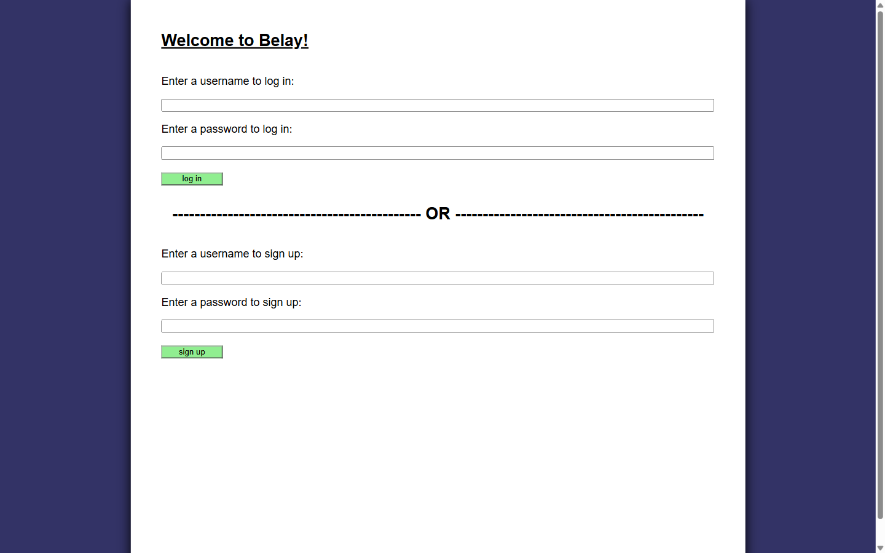
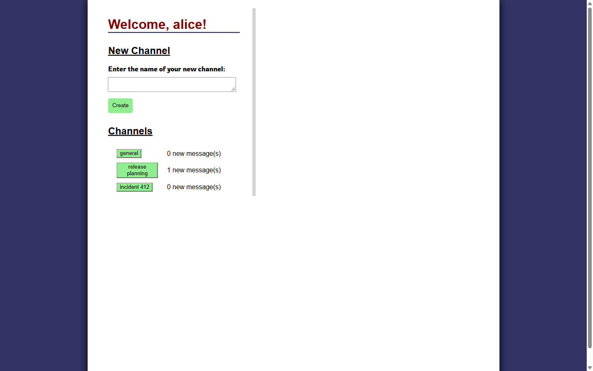
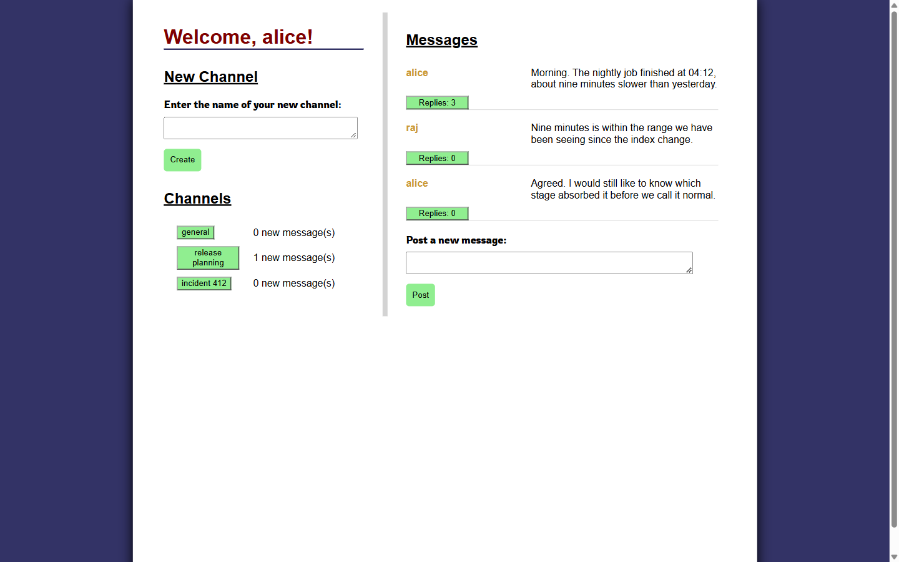
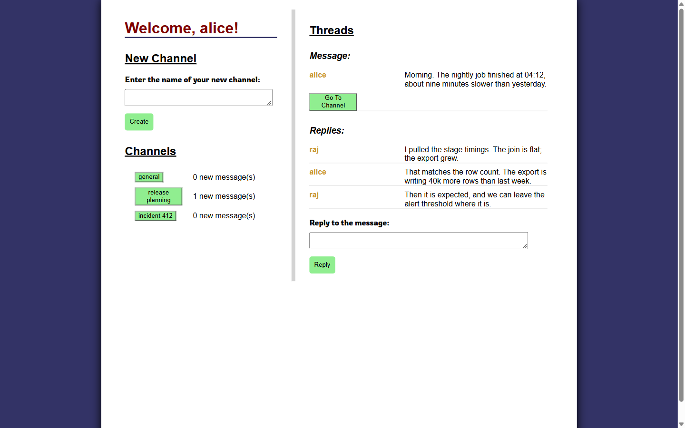

# Belay Real-Time Chat Application

Belay is a Slack-style chat application. The server is Flask over SQLite and the front
end is plain JavaScript with no framework. It supports accounts with hashed passwords,
channels, threaded replies, per-channel unread counts, and links that take you to the
exact message you were sent after you log in.

## Demo

Every screenshot below is the running application in a browser at `127.0.0.1:5000`.

### Signing in

Accounts are stored with a bcrypt hash and a server-issued key. The key goes in
`localStorage` and travels in the `Authorization` header on every later request.

### Channels and unread counts

The channel list shows how many messages have arrived in each channel since you last
read it. The count comes from the last message id you were shown, recorded per user and
per channel, so each person sees their own number. Here `general` is caught up and
`release planning` has one message waiting.

### Messages

Each message shows its author and how many replies it has. The reply count updates in
place while you are reading, without rebuilding the list under your cursor.

### Threads

Opening a thread shows the parent message with its replies underneath. The URL for this
view is `/channel/1/thread/1`, and it is shareable. If you send it to someone who is
logged out, they see the login form and land on this exact thread once they sign in.

## How to run the program

Install Requirements:
1. Type the following command to install the required python modules: "pip install -r requirements.txt"

Run App:
1. Type the following command to start the server: "python app.py"
2. Open a web browser and type the following url: "127.0.0.1:5000"

## How it works

The server exposes a small JSON API and serves one static page. The front end decides
what to show from `window.location.pathname`, and it uses `history.pushState` to move
between views, so the back button works and every view has a real URL.

| Route | Purpose |
|---|---|
| `GET /api/user` | Log in and receive the auth key |
| `POST /api/user` | Create an account |
| `GET /api/channel` | List channels |
| `POST /api/channel` | Create a channel |
| `GET /api/channel/<id>/message` | List a channel's messages with reply counts |
| `POST /api/channel/<id>/message` | Post a message |
| `GET /api/channel/<id>/message/<id>` | Read a message and its replies |
| `POST /api/channel/<id>/message/<id>` | Reply to a message |
| `GET /api/message/unread` | Unread counts for every channel |
| `POST /api/message/unread` | Record the last message a user has seen |

Four tables sit behind it. `user` holds the account and its bcrypt hash, `channel` holds the
names, `message` holds both messages and replies (a reply carries `is_reply` and the id
it answers), and `user_channel` records the last message each user saw in each channel.
